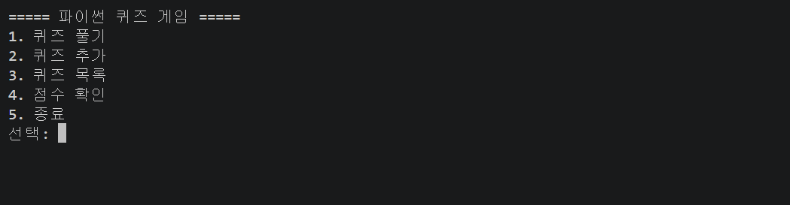
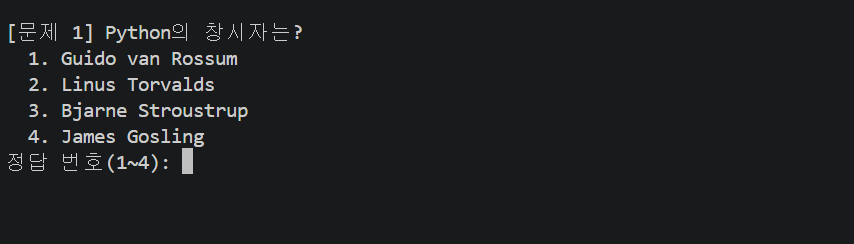
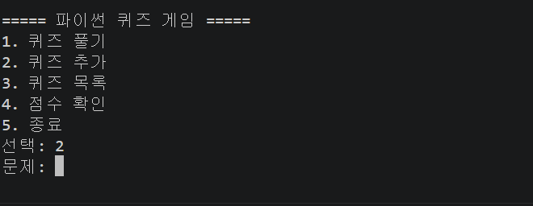
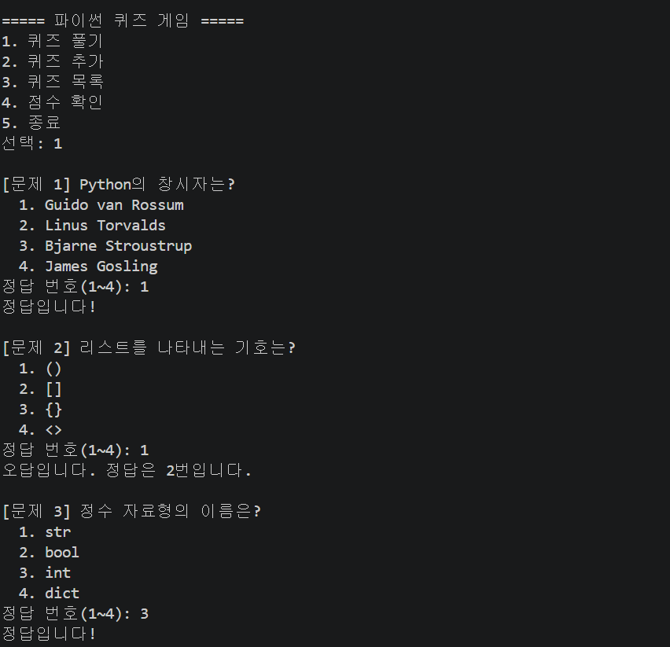

# 터미널 퀴즈 게임

## 프로젝트 개요
Python 표준 라이브러리만으로 만든 콘솔 객관식 퀴즈 게임입니다. 퀴즈 풀기·추가·목록·최고 점수 확인 기능이 있고,
추가한 퀴즈와 최고 점수는 `state.json`에 저장되어 재실행해도 유지됩니다.

## 퀴즈 주제 선정 이유
주제는 **파이썬 기초 문법**입니다. 이번 미션에서 직접 배운 내용(자료형, 반복문, 함수 등)이라
문제를 만들며 복습할 수 있고, 정답을 스스로 검증하기 쉬워서 선택했습니다.

## 실행 방법
Python 3.10 이상이 필요하며 외부 라이브러리는 필요 없습니다.

```bash
git clone <저장소 URL>
cd quiz-game
python3 main.py
```

## 기능 목록
- 메뉴 선택 (잘못된 입력·공백·빈 입력·범위 초과 시 재입력)
- 퀴즈 풀기: 정답/오답 안내, 전체 결과 표시, 퀴즈 없음 처리
- 퀴즈 추가: 문제·선택지 4개·정답 번호 입력 검증 후 파일 저장
- 퀴즈 목록 조회
- 최고 점수 확인 및 풀이 시 자동 갱신·저장
- `Ctrl+C` / 입력 종료(EOF) 시 저장 후 안전 종료
- 데이터 파일 없음 → 기본 퀴즈 사용, 손상 → 안내 후 기본 퀴즈로 복구

## 실행 화면
| 메뉴 | 퀴즈 풀기 |
|---|---|
|  |  |

| 퀴즈 추가 | 점수 확인 |
|---|---|
|  |  |

| 퀴즈 목록 | 정답/오답 안내 |
|---|---|
|  |  |

## 파일 구조
```
quiz-game/
├── main.py       # 실행 진입점
├── quiz.py       # Quiz 클래스 (문제, 출력, 정답 확인)
├── quiz_game.py  # QuizGame 클래스 (메뉴, 기능, 저장/불러오기)
├── state.json    # 실행 후 생성되는 저장 데이터 (git 제외)
├── docs/screenshots/  # 실행 화면 스크린샷
├── .gitignore
└── README.md
```

## 데이터 파일 설명
`state.json` (UTF-8)은 프로그램 실행 중 자동 생성됩니다.

```json
{
    "quizzes": [
        {"question": "Python의 창시자는?", "choices": ["Guido", "Linus", "Bjarne", "James"], "answer": 1}
    ],
    "best_score": 3
}
```
- `quizzes`: 퀴즈 목록. `answer`는 1~4 정답 번호
- `best_score`: 최고 점수 (아직 풀지 않았다면 `null`)

> clone 실습: 복제본에서 추가하고 pull로 가져온 한 줄입니다.
