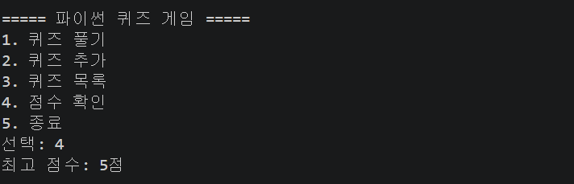
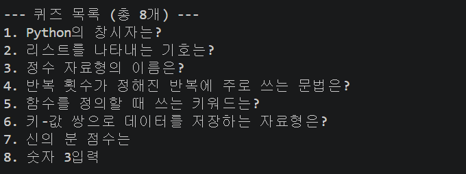
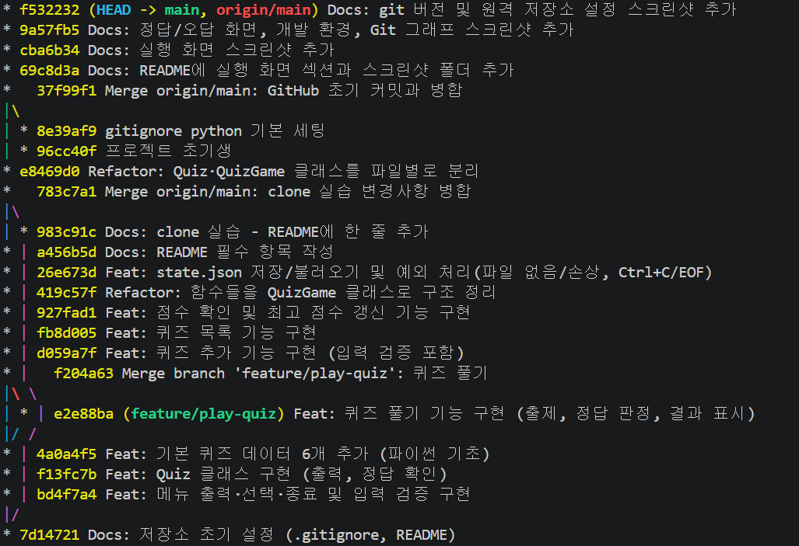
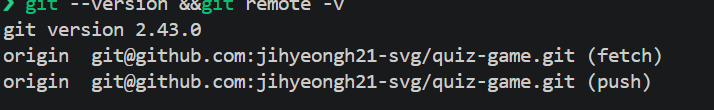
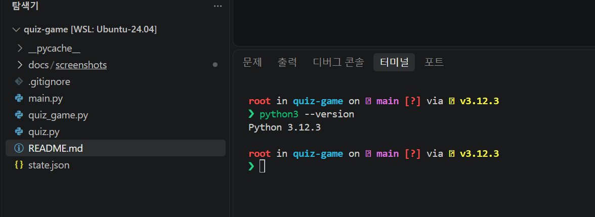

# 터미널 퀴즈 게임

## 프로젝트 개요
Python 표준 라이브러리만으로 만든 콘솔 객관식 퀴즈 게임입니다. 퀴즈 풀기·추가·목록·최고 점수 확인 기능이 있고,
추가한 퀴즈와 최고 점수는 `state.json`에 저장되어 재실행해도 유지됩니다.

## 퀴즈 주제 선정 이유
주제는 **파이썬 기초 문법**입니다. 이번 미션에서 직접 배운 내용(자료형, 반복문, 함수 등)이라
문제를 만들며 복습할 수 있고, 정답을 스스로 검증하기 쉬워서 선택했습니다.

## 실행 방법
Python 3.10 이상이 필요하며 외부 라이브러리는 필요 없습니다.

```bash
git clone <저장소 URL>
cd quiz-game
python3 main.py
```

## 기능 목록
- 메뉴 선택 (잘못된 입력·공백·빈 입력·범위 초과 시 재입력)
- 퀴즈 풀기: 정답/오답 안내, 전체 결과 표시, 퀴즈 없음 처리
- 퀴즈 추가: 문제·선택지 4개·정답 번호 입력 검증 후 파일 저장
- 퀴즈 목록 조회
- 최고 점수 확인 및 풀이 시 자동 갱신·저장
- **[보너스]** 랜덤 출제 / 풀 문제 수 선택 / 힌트(사용 시 점수 차감) / 퀴즈 삭제 / 플레이 기록 히스토리
- `Ctrl+C` / 입력 종료(EOF) / SIGTERM 시 저장 후 안전 종료
- 데이터 파일 없음 → 기본 퀴즈 사용, 손상 → 안내 후 기본 퀴즈로 복구

## 실행 화면
| 메뉴 | 퀴즈 풀기 |
|---|---|
|  |  |

| 퀴즈 추가 | 점수 확인 |
|---|---|
|  |  |

| 퀴즈 목록 | 정답/오답 안내 |
|---|---|
|  |  |

## 파일 구조
```
quiz-game/
├── main.py       # 실행 진입점
├── quiz.py       # Quiz 클래스 (문제, 출력, 정답 확인)
├── quiz_game.py  # QuizGame 클래스 (메뉴, 기능, 저장/불러오기)
├── state.json    # 실행 후 생성되는 저장 데이터 (git 제외)
├── docs/screenshots/  # 실행 화면 스크린샷
├── .gitignore
└── README.md
```

## 보너스 기능
| 기능 | 사용법 / 동작 |
|---|---|
| 랜덤 출제 | `random.sample`로 문제 순서를 섞고 중복 없이 출제 |
| 문제 수 선택 | 풀이 시작 시 1~전체 개수 사이로 입력 |
| 힌트 | 힌트가 있는 문제에서 `0` 입력 → 힌트 표시. 그 문제는 맞혀도 1점 대신 0.5점 |
| 퀴즈 삭제 | 메뉴 5번 → 번호 선택(0=취소) → 즉시 `state.json` 반영 |
| 플레이 기록 | 메뉴 6번. 풀이가 끝날 때마다 날짜/시간·푼 문제 수·점수를 저장하고 최근 10건 표시 |

점수는 정답 1점(힌트 사용 시 0.5점)의 합이며, 최고 점수는 풀이 문제 수와 관계없이 점수 자체로 비교합니다.
퀴즈 추가 시 힌트는 선택 입력(Enter로 건너뜀)입니다.

## 설계 설명

### 클래스를 사용한 이유와 책임 분리
- **`Quiz`** (`quiz.py`): 문제 한 개의 데이터(`question`, `choices`, `answer`)와 그 데이터에 딸린 동작(출력, 정답 확인, dict 변환)을 한곳에 묶습니다. 퀴즈마다 인스턴스를 만들어 재사용하며, 다른 UI(웹 등)로 바꿔도 그대로 쓸 수 있습니다.
- **`QuizGame`** (`quiz_game.py`): 퀴즈 목록·최고 점수라는 게임 상태와 메뉴 진행, 저장/불러오기를 관리합니다. "문제 한 개"와 "게임 전체"의 변경 이유가 다르므로 클래스를 나눴습니다.

### 로직 맵
| 역할 | 위치 | 이유 |
|---|---|---|
| 입력 검증 | `QuizGame.read_int`, `read_text` | 모든 입력이 한 경로를 거쳐 검증 규칙이 일관됨 |
| 정답 판정 | `Quiz.is_correct` ← `QuizGame.play`가 호출 | 판정 규칙은 문제 객체가 책임짐 |
| 게임 진행 | `QuizGame.play`, `add_quiz`, `list_quizzes`, `show_best_score`, `run` | 메뉴 번호와 기능을 `run`의 dict로 연결 |
| 데이터 입출력 | `QuizGame.load_state`, `save_state`, `backup_corrupt_file`, `Quiz.to_dict/from_dict` | 파일 형식 변경 시 이 부분만 수정 |

### 정답 판정 흐름
`play()` → `quiz.display(번호)` 출력 → `read_int`로 1~4 입력 → `quiz.is_correct(입력)` 결과에 따라 정답/오답 안내와 점수 가산 → 결과 출력 → `update_best_score(점수)`.

### state.json 로드·저장 시점
1. **로드**: `QuizGame()` 생성 시 `load_state()`가 한 번 실행됩니다. 파일이 없으면 기본 퀴즈, 손상되면 안내 후 `state.json.corrupt`로 원본을 보관하고 기본 퀴즈로 초기화·재저장합니다.
2. **저장**: 퀴즈 추가·삭제 직후, 풀이 종료 직후(기록·최고 점수), `Ctrl+C`/EOF/SIGTERM 종료 시 `save_state()`가 실행됩니다.
3. 정상 종료(메뉴 5번)는 변경이 있을 때마다 이미 저장했으므로 추가 저장이 필요 없습니다.

### 예외 처리와 복구
- 입력: 공백 제거, 빈 입력, 숫자 변환 실패, 범위 밖 모두 안내 후 재입력
- `KeyboardInterrupt`/`EOFError`/SIGTERM: 안내 메시지 후 저장하고 종료 (SIGTERM은 `signal`로 같은 경로에 연결)
- 파일 손상(JSON 오류, 형식 오류, 인코딩 오류): 원본을 `state.json.corrupt`로 보관 → 기본 퀴즈로 복구. 사용자는 보관된 파일을 열어 수동 복구할 수 있습니다.
- 파일 입출력 오류(`OSError`, 권한 등): 메시지를 출력하고 게임은 계속 진행합니다. 자동 대체 경로는 구현하지 않았습니다.

### 규모에 대한 고려
퀴즈를 전부 메모리의 list로 들고 있고 저장 시 파일 전체를 다시 씁니다. 수백 개 수준에서는 문제가 없지만 1000개 이상이 되면
저장 시간이 늘어납니다. 그때는 변경분만 저장하는 방식이나 `sqlite3`(표준 라이브러리)로 전환할 수 있고,
저장 로직이 `QuizGame`의 `load_state`/`save_state`에 모여 있어 교체 범위가 작습니다.

### 요구사항이 바뀔 때 수정할 곳
| 변경 | 수정 대상 |
|---|---|
| 점수 계산 방식(힌트 감점 등) | `QuizGame.HINT_PENALTY`, `ask_answer`, `play`, `update_best_score` |
| 퀴즈 항목 추가 | `Quiz.__init__`, `to_dict`, `from_dict`, `add_quiz`, 기본 퀴즈 |
| 저장 형식 변경 | `load_state`, `save_state`, `Quiz.to_dict/from_dict` |
| 메뉴 추가 | `QuizGame.menu_items`에 (이름, 메서드) 한 줄 + 새 메서드 |

### 기본 퀴즈 (파이썬 기초 6문제)
| # | 문제 | 정답 |
|---|---|---|
| 1 | Python의 창시자는? | 1. Guido van Rossum |
| 2 | 리스트를 나타내는 기호는? | 2. `[]` |
| 3 | 정수 자료형의 이름은? | 3. `int` |
| 4 | 반복 횟수가 정해진 반복에 주로 쓰는 문법은? | 2. `for` |
| 5 | 함수를 정의할 때 쓰는 키워드는? | 4. `def` |
| 6 | 키-값 쌍으로 데이터를 저장하는 자료형은? | 1. `dict` |

## 재실행 시 데이터 유지 확인
1. 실행 → 2번으로 퀴즈 추가, 1번으로 풀이 후 종료 → `state.json`에 새 퀴즈와 `best_score`가 기록됨
2. 다시 `python3 main.py` 실행 → 3번 목록에 추가한 퀴즈가 보이고(`list.png`), 4번에서 같은 최고 점수가 표시됨(`score.png`)

## Git 작업 기록
- 저장소: https://github.com/jihyeongh21-svg/quiz-game
- 커밋 20개 이상, 브랜치 `feature/play-quiz`를 만들어 `main`에 병합
- clone 실습: 별도 디렉터리에 clone → README 수정 후 push → 원래 디렉터리에서 pull(병합)
- 커밋 메시지 규칙: `Feat:` 기능, `Fix:` 버그, `Docs:` 문서, `Refactor:` 구조 정리 + 작업 내용. 기능 하나가 끝날 때마다 커밋합니다.





## 데이터 파일 설명
JSON은 사람이 읽기 쉽고 list/dict 구조를 그대로 저장할 수 있으며 표준 라이브러리(`json`)만으로 다룰 수 있어 선택했습니다.

`state.json` (UTF-8)은 프로그램 실행 중 자동 생성됩니다.

```json
{
    "quizzes": [
        {"question": "Python의 창시자는?", "choices": ["Guido", "Linus", "Bjarne", "James"], "answer": 1, "hint": "네덜란드 출신입니다."}
    ],
    "best_score": 3,
    "history": [
        {"played_at": "2026-11-18 10:40:48", "total": 6, "score": 3.5}
    ]
}
```
- `quizzes`: 퀴즈 목록. `answer`는 1~4 정답 번호
- `hint`: 힌트 문구 (없으면 빈 문자열, 이전 형식 파일에서는 생략 가능)
- `history`: 풀이 기록 목록 (이전 형식 파일에서는 생략 가능)
- `best_score`: 최고 점수 (아직 풀지 않았다면 `null`)

> clone 실습: 복제본에서 추가하고 pull로 가져온 한 줄입니다.
